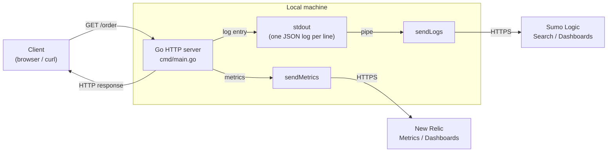

# Go Log Generator (Stdout → Sumo Logic / New Relic)

This project is a simple **Golang HTTP service** that runs **locally** and generates **structured logs to stdout**. Two scripts ship the telemetry out:

* **`sendLogs`** forwards the log stream to **Sumo Logic**
* **`sendMetrics`** forwards metrics to **New Relic**

The goal is to demonstrate an **end-to-end observability pipeline** suitable for SRE use cases.

---

## 🧩 What This Project Does

* Runs a Go HTTP web server
* Exposes an endpoint (e.g. `/order`)
* On each request:
  * Generates a log entry containing:
    * timestamp
    * environment
    * HTTP status
    * message
  * Writes logs to **stdout** (not files)
* Logs are shipped to **Sumo Logic** by `sendLogs`
* Metrics are shipped to **New Relic** by `sendMetrics`

---

## 🏗 Architecture Overview



---

## 📁 Project Structure

```
go-log-generator/
├── cmd/main.go
├── go.mod
└── README.md
```

---

## ⚙️ Configuration

The application is configured using environment variables:

| Variable | Description | Example |
|--------|------------|--------|
| `APP_ENV` | Application environment | `dev`, `test`, `prod` |
| `APP_PORT` | HTTP port to listen on | `8081` |

If `APP_PORT` is not set, the app falls back to its built-in default port.

---

## 🚀 Running Locally

### Prerequisites

* Go installed (version as declared in `go.mod`)
* `curl`
* `sendLogs` and `sendMetrics` configured with their Sumo Logic and New Relic credentials

### 1️⃣ Start the Server

From the project root:

```bash
APP_ENV=dev APP_PORT=8081 go run ./cmd
```

Or build a binary and run it:

```bash
go build -o bin/go-log-generator ./cmd
APP_ENV=dev APP_PORT=8081 ./bin/go-log-generator
```

### 2️⃣ Ship the Logs and Metrics

Run `sendLogs` against the app's stdout and `sendMetrics` alongside it, following each script's own usage.

### 3️⃣ Test the Endpoint

In a second terminal:

```bash
curl -i http://localhost:8081/order
```

### 4️⃣ Expected Results

* `curl` receives an HTTP `200` response
* The server terminal prints one JSON log line per request
* The log line appears in Sumo Logic via `sendLogs`
* Metrics for the request appear in New Relic via `sendMetrics`

Stop the server with `Ctrl+C`.

---

## 🧾 Logging Design

* Logs are written to **stdout only**
* One log event per line
* No multiline logs
* Structured format (JSON)

### Example Log

```json
{
  "timestamp": "2026-01-29T15:22:10Z",
  "env": "dev",
  "http_status": 200,
  "message": "order processed successfully"
}
```

This format is intentionally designed for:

* Easy ingestion
* Field Extraction Rules (FER)
* Low parsing overhead in Sumo Logic

---

## 📡 Log and Metrics Shipping

### Logs → Sumo Logic (`sendLogs`)

* Reads the JSON log stream from stdout
* Sends each structured log line as a single Sumo Logic event

### Metrics → New Relic (`sendMetrics`)

* Sends application metrics to New Relic

---

## 🔎 Verifying in Sumo Logic

### Example Queries

Count logs by environment:

```
| count by env
```

Count by HTTP status:

```
| count by http_status
```

---

## 🧠 Key Design Decisions

* **stdout logging** instead of file-based logging
* Logs and metrics shipped by separate scripts, so the app has no vendor SDK dependency
* Separation of:
  * User response
  * Application logs
  * Observability pipeline

---

## 🚨 Common Pitfalls

* Using `log.Fatal` inside request handlers
* Writing logs to files instead of stdout
* Multi-line or unstructured logs
* Hardcoding ports or environments
* Not handling `ListenAndServe` errors

---

## 🎯 Future Enhancements

* Add structured JSON responses
* Add request IDs / correlation IDs
* Add OpenTelemetry tracing
* Deploy to Kubernetes
* Add dashboards and alerts in Sumo Logic and New Relic

---

## 👤 Author

**Fadi Kaba**
Senior SRE / Cloud & Observability Engineer

---
